# Cloud-Based Data Lake Integration & Reporting System

Event-driven **bronze → silver → gold** data lake with Glue-like ETL jobs,
Lambda-like event handlers, Athena-style SQL (DuckDB), and an HTML KPI
dashboard — all running locally.

## Architecture

```mermaid
flowchart LR
    SRC[Event sources] --> BRZ[(Bronze\nraw events)]
    BRZ -->|S3:ObjectCreated| L1[Lambda\nbronze-arrived]
    L1 --> GLUE1[Glue job\nclean & dedupe]
    GLUE1 --> SLV[(Silver\nclean events)]
    SLV -->|S3:ObjectCreated| L2[Lambda\nsilver-arrived]
    L2 --> GLUE2[Glue job\ndaily aggregates]
    GLUE2 --> GLD[(Gold\ndaily KPIs)]
    GLD -->|S3:ObjectCreated| L3[Lambda\ngold-arrived]
    L3 --> ATH[Athena queries\nDuckDB SQL]
    ATH --> RPT[HTML dashboard]
```



| AWS component | Local simulation |
|---|---|
| S3 bronze/silver/gold prefixes | `lake/{bronze,silver,gold}/` + manifests |
| AWS Glue jobs | `src/glue_jobs.py` pandas jobs |
| Lambda event triggers | `lambda_handlers/handlers.py` |
| Amazon Athena | DuckDB SQL over Parquet (`src/athena.py`) |
| QuickSight | `src/reporting.py` → `output/dashboard.html` |

## What it does

1. **Bronze ingest** — 30K synthetic events land as Parquet with a catalog
   manifest (mimics S3 inventory).
2. **Lambda → Glue (silver)** — the bronze-arrived handler triggers cleaning:
   drops null keys, dedupes, standardizes types/dates.
3. **Lambda → Glue (gold)** — the silver-arrived handler builds daily KPI
   aggregates by date × event type × country.
4. **Lambda → refresh** — the gold-arrived handler stamps the refresh.
5. **Athena + dashboard** — DuckDB runs KPI overview, revenue by country,
   event funnel, and daily trend queries; results render as a styled HTML
   dashboard (inline SVG bars, no JS).

## How to run

```bash
pip install -r requirements.txt
python main.py
# then open output/dashboard.html in a browser
```

## Sample output

```
[lake] bronze/events: 30,000 rows
[lambda:bronze-arrived] table=events rows=30,000 -> triggering silver clean job
[lake] silver/events_clean: 29,800 rows
[lambda:silver-arrived] -> triggering gold aggregate job
[lake] gold/daily_kpis: 10,800 rows
[athena] querying the lake with DuckDB:
  -- kpi_overview --
   events  users   revenue
    29800   7812  1339841.55
[report] dashboard -> output/dashboard.html
```

## Technologies

Python, pandas, NumPy, PyArrow, DuckDB — mirroring S3, Glue, Lambda,
Athena, and QuickSight patterns.
